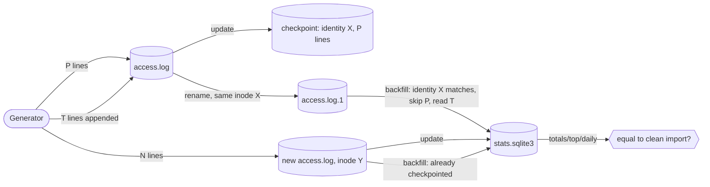
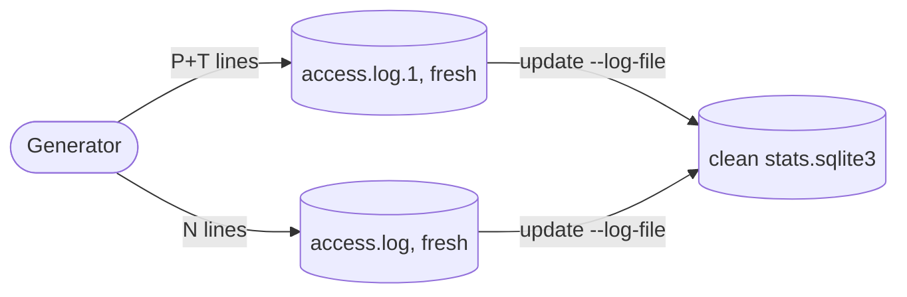
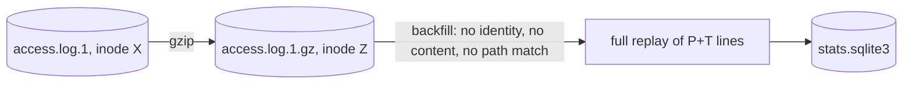
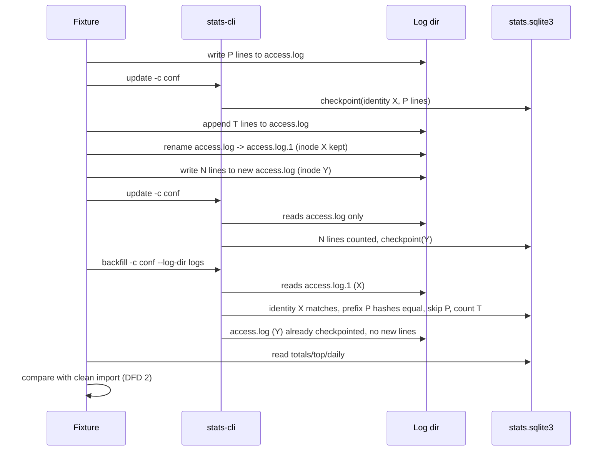
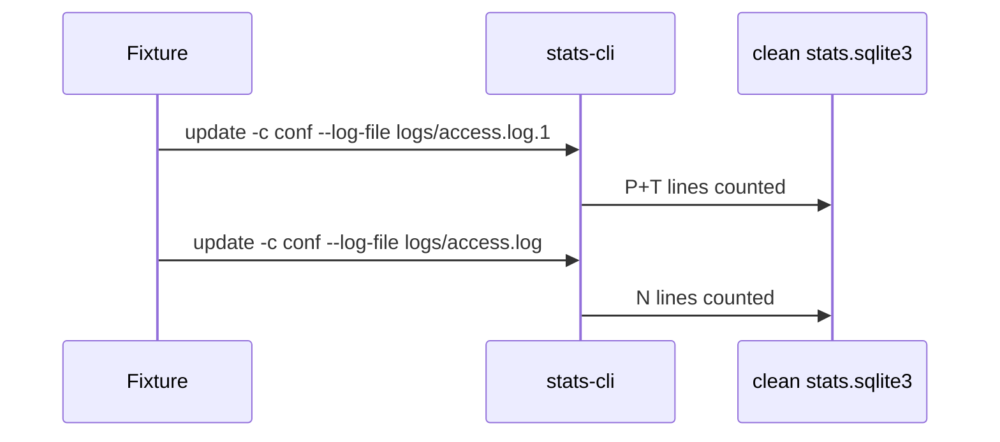
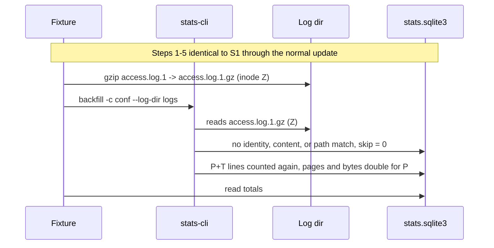

# Behavior: Rotation Boundary Contract

Record sets: `P` = 100 prefix records (already checkpointed), `T` = 50 tail records (appended after the checkpoint, before rename), `N` = 30 new-active records. The clean reference imports `P+T` records as the rotation, then `N` as the active file.

## Data Flow Diagrams

### DFD 1: Plain rotation, then backfill (scenario S1)

### DFD 2: Clean import (reference)

### DFD 3: Gzip before backfill (scenario S2)

---

## Sequence Diagrams

### Use Case 1: Plain rotation recovers the tail (S1)

**Assertions:**
- After the normal update (before backfill): totals equal `P + N` (130 in the scratch run). The prefix `P` was counted by the first update; the tail `T` is absent because it is unread. (Acceptance criterion 2.)
- After backfill: totals equal `P+T+N` and equal the clean import. (Criterion 1.)

**Error and edge cases:**
| Condition | Expected behaviour | Covered by |
|---|---|---|
| New active file missing at normal update | `update` fails with `inspect log file` context | Not in initial scope; see 04-testing.md "Deferred" |
| Second backfill, nothing changed | No aggregate change ("unchanged input") | T3 |
| Prefix hash mismatch (file edited in place) | Replay path; not exercised by this feature | Deferred |

### Use Case 2: Clean import reference

The documented manual sequence (`docs/operations.md:34-38`, oldest to newest) is used here, which is the reference the fixture compares against.

### Use Case 3: Compressed rotation before backfill (S2) - normative outcome P+T+N, counted once, current defect fixed in Phase 2

Observed in the scratch run for `.gz` (research document): 280 pages and 34,590 bytes against 180 and 22,140 for the clean import, with `visits` unchanged at 180. `.bz2` and `.xz` use the same decode-then-match path (`main.rs:409-431`), so they are expected to show the same defect; T4-bz2 and T4-xz confirm this in Phase 1.

**Phase 2 target flow:** after the rotated file is decoded, its first `decoded_size` bytes are hashed and matched against the stored decoded-prefix checkpoint for the config hash. A unique match skips the stored line count and writes a checkpoint for the new identity. No match or an ambiguous match is diagnosed. See D-9 in `03-decisions.md`.

## Additional Scenarios

### Repeated backfill
- **Trigger:** backfill run twice with no file changes.
- **Behaviour:** identity and content match; `skip_lines` equals the full line count (`crates/stats-cli/src/main.rs:931-937`). No change.

### Non-Unix platforms
- **Trigger:** test run on a non-Unix target.
- **Behaviour:** `file_identity` returns `"portable"` for every file (`main.rs:1170-1177`), so identity matching is not inode-based and the S1 expectations do not hold. The fixture is `#[cfg(unix)]` and is skipped elsewhere with a message.
