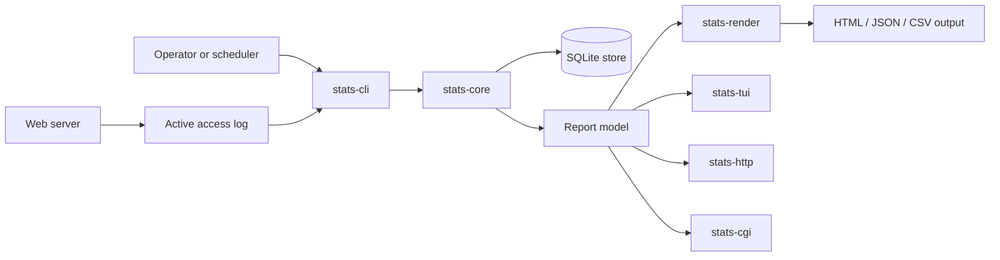
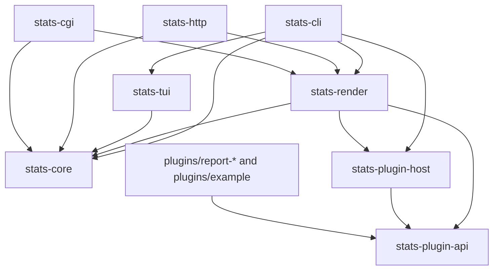
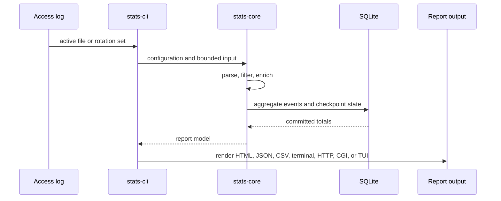
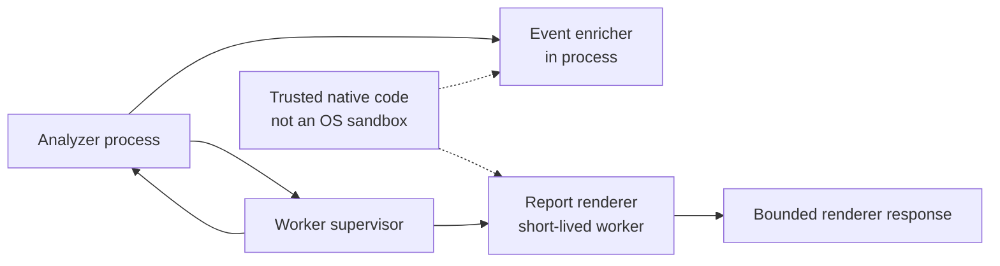
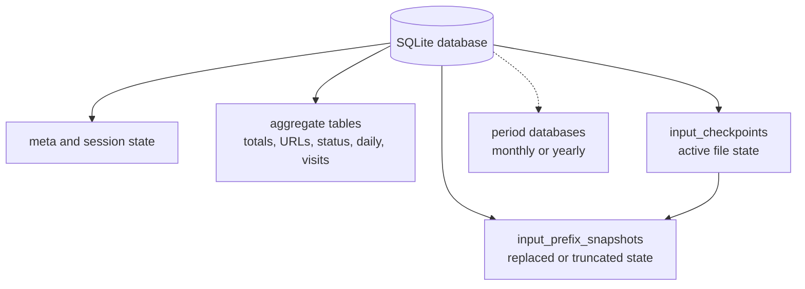

# Architecture

This page describes runtime relationships. Package-specific responsibilities
are maintained in the [module guide](README.md#architecture-and-modules), while
operator guarantees remain in [Operations](operations.md).

## System context

The analyzer is split at the report model: ingestion and persistence happen in
`stats-core`, orchestration happens in `stats-cli`, and presentation adapters
consume report data. The web server writes logs; it is not controlled by the
analyzer and must be configured to reopen its file after rotation.

## Workspace dependency map

The arrows describe compile-time ownership, not network calls. `stats-core` is
the domain base; frontends do not depend on each other.

## Workspace boundaries

The workspace contains 12 packages covering core parsing and storage, CLI,
HTTP/CGI/TUI frontends, renderers, and plugins. The main execution path is:

1. A frontend reads configuration and selects the input source.
2. `stats-core` parses records into normalized events and applies GeoIP and
   plugin enrichment.
3. SQLite storage updates aggregates and append checkpoints.
4. The shared report query API reads aggregates.
5. HTML, JSON, CSV, terminal, HTTP, CGI, and TUI consumers render the result.

`stats-core` owns normalized events, parsing, GeoIP providers, plugin traits,
storage, and report queries. `stats-cli` owns orchestration and output. HTML,
terminal summaries, and the Ratatui dashboard consume the shared report query
API rather than accessing storage directly.

## Ingestion sequence

For unpartitioned `update` and `backfill`, planning, aggregate writes,
checkpoint changes, and metadata changes are one transaction. A failed
preflight or input verification aborts the transaction.

## Plugin trust boundary

Event enrichers execute directly in the analyzer. Report renderers are isolated
from a direct crash by a worker boundary, but both paths require trusted native
code and neither is a security sandbox.

## Storage and processing

The default layout uses a single SQLite database. Optional monthly or yearly
partitioning keeps control/session state in `DirData/stats.sqlite3` and places
event aggregates under `DirData/periods/`. Reports federate period databases.
Append checkpoints use the stable source identity and complete-line prefix digests.
Replacement or truncation adds the new records to existing aggregates and keeps the
superseded state as a snapshot; see [Operations](operations.md#replacement-and-truncation-are-additive).
Unpartitioned updates and backfills commit in one transaction.

SQLite uses WAL mode, a five-second busy timeout, normal synchronous durability,
and in-memory temporary storage. `backup`, `optimize`, `storage`, and `retention`
are explicit operational commands rather than hidden background services.

## Persistence model

The default store keeps all data in one database. Partitioned deployments keep
control and session state in the control database and route event aggregates to
period databases. Checkpoints and snapshots are control data used to prevent
recounting; they are not an event log and cannot remove already-counted events.

## Reporting and plugins

The default HTML path is a static multi-page report. External report renderers
are separate dynamic libraries and are loaded only when configured and requested.
Event-enrichment callbacks are invoked directly by the analyzer through the
loaded plugin and therefore run in the analyzer process. Native report-renderer
calls use short-lived supervised workers with bounded IPC. The worker boundary
protects the parent frontend from a direct report-plugin crash, but does not
provide OS sandboxing or descendant-process cleanup; it does not protect
in-process event callbacks.

See [Plugins](plugins.md), [Operations](operations.md), and
[AWStats compatibility](compatibility.md) for the operational and behavioral
details of these boundaries.
