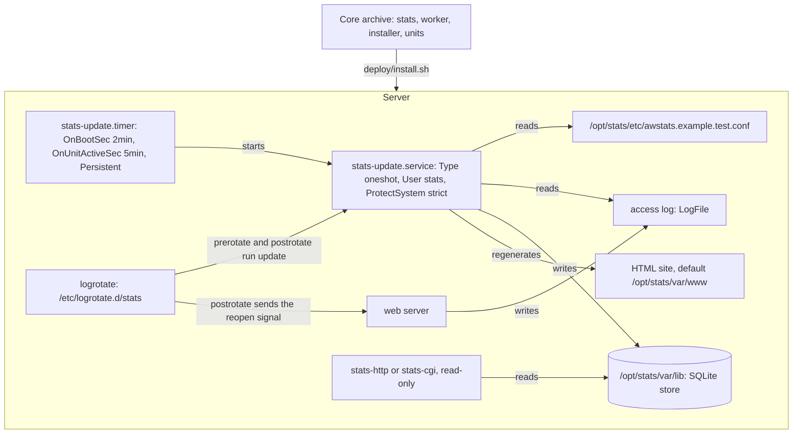

# Deployment

## Installed layout

The supplied installer keeps application-owned files under `/opt/stats/`:

- `/opt/stats/bin/stats` — analyzer executable
- `/opt/stats/bin/stats-report-worker` — isolated native report-plugin worker
- `/opt/stats/etc/awstats.example.test.conf` — expected configuration path
- `/opt/stats/var/lib` — SQLite data
- `/opt/stats/var/www` — generated reports
- `/opt/stats/lib/` — trusted native plugins

System-managed units remain under `/etc/systemd/system/` and logrotate remains
under `/etc/logrotate.d/`. Override application paths with
`STATS_BINARY_PATH`, `STATS_CONFIG_PATH`, `STATS_DATA_DIR`, and `STATS_OUTPUT_DIR`.
Set `STATS_CONFIG_SOURCE` to install an existing AWStats-compatible
configuration into the target path on a fresh install.

## Installer and systemd

Build a release binary, install the configuration, then run:

```text
sudo deploy/install.sh
systemctl start --wait stats-update.service
```

`deploy/install.sh` creates the `stats` system account and data/output
directories, installs the binary and `stats-update.service`/`stats-update.timer`,
installs `STATS_CONFIG_SOURCE` (or the bundled example configuration) when the target path is absent,
reloads systemd, and leaves the timer disabled unless `STATS_ENABLE_TIMER=1`
is supplied. It never overwrites an existing configuration. Review and adapt
the configuration before enabling the timer.

The service is restricted with `NoNewPrivileges`, `PrivateTmp`, `ProtectHome`,
`ProtectSystem=strict`, and explicit writable paths. The service account still
needs read access to the active log and GeoIP databases and write access to the
data and output directories.

The supplied logrotate template creates the active log as `root:stats` with
mode `0640`, so the `stats` service can read it after rotation. The installer
renders the configured `STATS_GROUP` into the template; if the web server has a
different file-creation requirement, preserve read access for that group.

If a configuration points at production paths such as
`/var/log/nginx/access.log` or `/var/lib/awstats`, run as the service account
with those permissions, or override both paths explicitly for a local run.

### macOS

The Linux installer and systemd units are not used on macOS. Build the
workspace for the host architecture and install the CLI and native worker
side by side:

```text
cargo build --workspace --release
mkdir -p "$HOME/.local/bin"
cp target/release/stats-cli "$HOME/.local/bin/stats"
cp target/release/stats-report-worker "$HOME/.local/bin/"
```

For periodic updates, render `deploy/com.avkghost.stats-update.plist` with
absolute values for `@STATS_BINARY_PATH@`, `@STATS_CONFIG_PATH@`, and
`@STATS_LOG_DIR@`, then load it with `launchctl`:

```text
mkdir -p "$HOME/Library/LaunchAgents" "$HOME/.local/var/log"
sed \
  -e "s#@STATS_BINARY_PATH@#$HOME/.local/bin/stats#g" \
  -e "s#@STATS_CONFIG_PATH@#$HOME/.config/stats/awstats.conf#g" \
  -e "s#@STATS_LOG_DIR@#$HOME/.local/var/log#g" \
  deploy/com.avkghost.stats-update.plist \
  > "$HOME/Library/LaunchAgents/com.avkghost.stats-update.plist"
plutil -lint "$HOME/Library/LaunchAgents/com.avkghost.stats-update.plist"
launchctl bootstrap "gui/$(id -u)" \
  "$HOME/Library/LaunchAgents/com.avkghost.stats-update.plist"
launchctl kickstart -k "gui/$(id -u)/com.avkghost.stats-update"
```

The plist uses a five-minute `StartInterval`; it does not run at login unless
`RunAtLoad` is added. To unload it, use `launchctl bootout` with the same
`gui/$(id -u)` domain and plist path.

Cross-target release packaging is supported by setting both variables, for
example `STATS_PLATFORM=macos-arm64 STATS_TARGET=aarch64-apple-darwin` or
`STATS_PLATFORM=macos-x86_64 STATS_TARGET=x86_64-apple-darwin`. The package
contains the CLI, `stats-report-worker`, and the `.dylib` report plugins.

## Upgrade, backup, and rollback

Before replacing the binary, changing storage settings, or restoring an older
deployment, stop scheduled and in-progress updates:

```text
sudo systemctl stop stats-update.timer
sudo systemctl stop stats-update.service
```

Create a backup before the change:

```text
sudo -u stats /opt/stats/bin/stats backup \
  --data-dir /opt/stats/var/lib \
  --output-dir /opt/stats/var/backups/pre-upgrade
```

For a rollback, restore the selected binary, configuration, and SQLite backup
using the deployment's normal file-ownership and permission rules. Validate the
restored configuration and data before making them active:

```text
sudo -u stats /opt/stats/bin/stats validate \
  --config /opt/stats/etc/awstats.example.test.conf
sudo -u stats /opt/stats/bin/stats health \
  --config /opt/stats/etc/awstats.example.test.conf \
  --data-dir /opt/stats/var/lib
sudo -u stats /opt/stats/bin/stats summary \
  --data-dir /opt/stats/var/lib --limit 10
```

Review the summary and confirm the expected report data before restarting the
service. Then reload systemd, run one update, and re-enable the timer:

```text
sudo systemctl daemon-reload
sudo systemctl start --wait stats-update.service
sudo systemctl enable --now stats-update.timer
```

Keep the pre-upgrade backup until the restored or upgraded deployment has been
verified. Do not use `rebuild` as a rollback mechanism: it clears derived
aggregates and replays input rather than restoring the previous database state.

## Cron and logrotate

The supplied logrotate template is systemd-backed. It runs the update service
before rotation, then expects the web server to reopen its file, and runs the
update service again after rotation. The effective order is:

```text
prerotate:
    systemctl start --wait stats-update.service
rotation happens here
postrotate:
    send the deployment-specific reopen signal to the web server
    systemctl start --wait stats-update.service
```

For a deployment that does not use the supplied systemd units, an equivalent
cron entry is:

```text
*/5 * * * * stats /opt/stats/bin/stats update --config /opt/stats/etc/awstats.example.test.conf >/var/log/stats-update.log 2>&1
```

The templates are `deploy/stats-update.service`, `deploy/stats-update.timer`,
and `deploy/stats-logrotate`. Install the service and timer under
`/etc/systemd/system/` and the logrotate file under `/etc/logrotate.d/stats`.

## Release bundles

Create a self-contained Linux bundle with:

```text
bash deploy/package-release.sh
```

The package script derives the version from `crates/stats-cli/Cargo.toml` unless
`STATS_VERSION` is supplied. A tag value such as `v0.1.2` is normalized to
`0.1.2`. `STATS_PLATFORM`, `STATS_TARGET`, and `STATS_RELEASE_DIR` are also supported. Checksums use `sha256sum` when available and fall back to macOS `shasum -a 256`. It refuses
to package when an explicitly supplied version differs from the crate version.
The script creates four archives, each with a `.sha256` sidecar:

- `stats-<version>-<platform>` — `stats`, `stats-report-worker`, the installer,
  systemd/logrotate files, example configuration, README, and changelog;
- `stats-http-<version>-<platform>` — `stats-http` and `stats-report-worker`;
- `stats-cgi-<version>-<platform>` — `stats-cgi` and `stats-report-worker`;
- `stats-plugins-<version>-<platform>` — the HTML, JSON, and CSV native report
  libraries.

The archives do not include source code, the full documentation tree, a database,
or generated reports. Linux and macOS release workflows publish the same four
archive types for their respective platforms. `stats-report-worker` must remain beside every frontend
that renders native reports. Run `bash deploy/verify-release-artifacts.sh
<artifact-dir>` to verify checksums and required archive contents.

Set `DirOutput` in the configuration to choose where the automatically
regenerated HTML site is written. If it is omitted, the site is written to an
`output` directory beside `DirData`.

## HTTP and CGI boundaries

For CGI and HTTP deployments, the effective `DirData` directory is the only
request-readable root. Requested database and `urlalias` files are canonicalized
before access, so traversal and symlink escapes are rejected. External renderer
libraries are trusted startup inputs from deployment configuration and are not
request-controlled.

Report failures return a generic HTTP 500 response or a generic CGI 500 response
with valid CGI headers. Detailed diagnostics remain server-side.

The HTTP frontend has a disabled-by-default `/raw-log` diagnostic endpoint; CGI
supports `output=raw-log`. Set a non-empty `STATS_RAW_LOG_AUTH_TOKEN` and have a
reverse proxy inject `Authorization: Bearer <token>`. Both paths return only
redacted records, limit requests to 10,000 lines, support optional line ranges,
and read the configured log only when it is inside `DirData`.

See [Operations](operations.md) for rotation, retention, backups, and migration.

## Deployment topology


