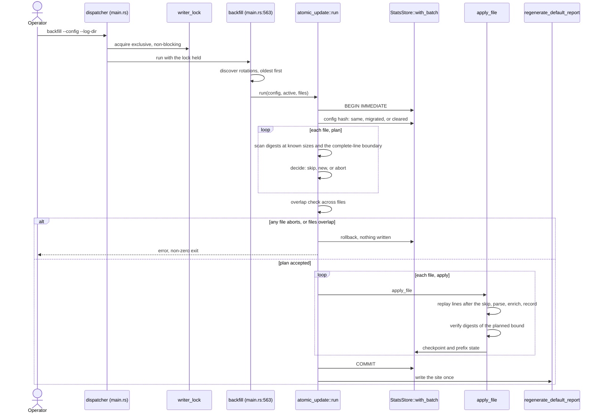
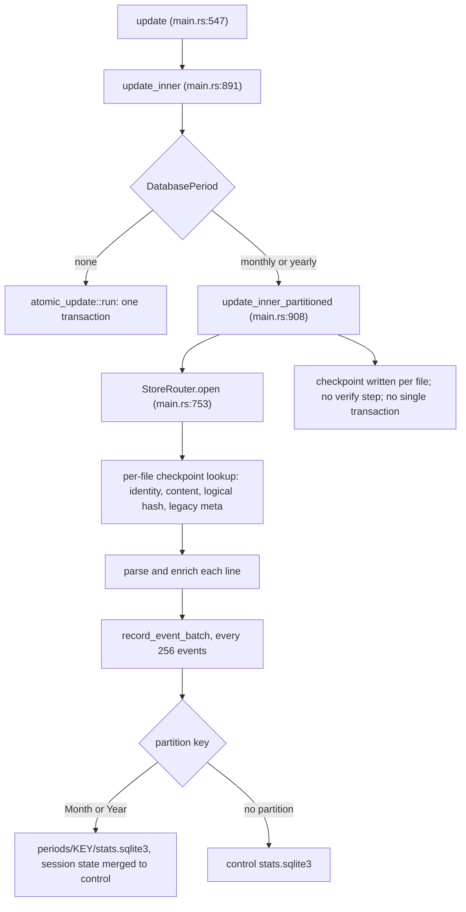
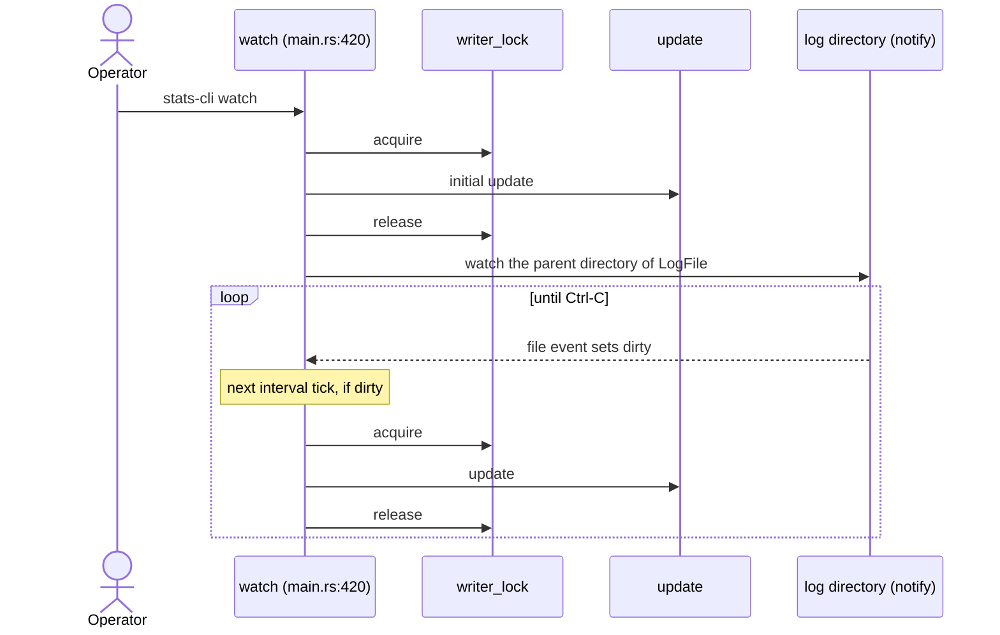
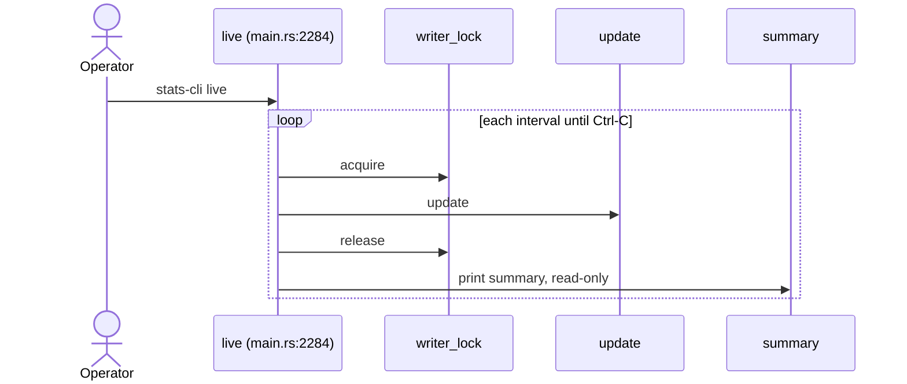
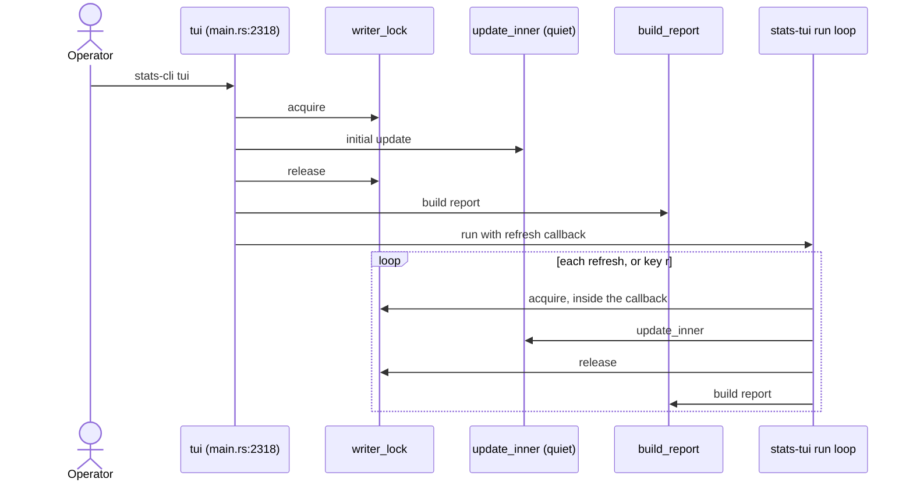
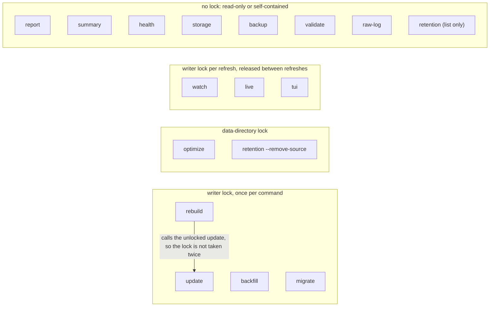

# `stats-cli`

`stats-cli` is the orchestration layer and the primary operator interface. It
loads configuration, selects input files, coordinates `stats-core`, and invokes
renderers or frontend loops.

## Command groups

| Group | Commands | Purpose |
| --- | --- | --- |
| Ingestion | `update`, `rebuild`, `backfill`, `migrate` | Read logs and update single or partitioned stores |
| Reports | `report`, `summary`, `health`, `storage` | Query, render, and inspect stored data |
| Runtime | `watch`, `live`, `tui` | Refresh reports or dashboards |
| Maintenance | `backup`, `optimize`, `retention` | Protect, compact, and remove historical data |
| Diagnostics | `validate`, `raw-log` | Check configuration and produce bounded redacted output |
| Plugin | `plugin-worker` | Run a renderer worker process |

## Ingestion ownership

`main.rs` owns command dispatch and compatibility-oriented CLI behaviour.
`atomic_update.rs` owns planning, preflight, overlap checks, apply, and commit
for unpartitioned writes. `writer_lock.rs` protects writers on Unix. The
`reverse_dns.rs` module is opt-in enrichment and is not part of the core parser.

Normal `update` reads only the configured active log. `backfill` discovers the
rotation family and processes it oldest-first. The complete-line rule, compressed
prefix matching, copytruncate handling, and recovery procedure are normative in
[Operations](../operations.md#rotation-and-backfill).

## Write safety

- The dispatcher acquires the advisory writer lock once for a writing command.
- Unpartitioned update and backfill plan and apply inside one transaction.
- Preflight verifies input digests before commit; failures leave no partial
  aggregate or checkpoint changes.
- Partitioned `backfill` is refused. `migrate` uses its dedicated partitioned
  replay path.
- `watch`, `live`, and `tui` acquire the lock per refresh so they do not block
  manual commands for their entire process lifetime.

See [Operations](../operations.md#locking) for lock scope and cost, and the
[rotation contract](../rotation-boundary-contract/README.md) for the fixture
and acceptance tests.

## Configuration and health checks

The unpartitioned atomic path fingerprints the configuration bytes with
SHA-256. A legacy fingerprint is migrated in place; a genuinely different
configuration clears aggregates and checkpoints inside the same transaction
before replay. This logic is in `atomic_update.rs` and is covered by the
configuration migration tests.

`health` is read-only. It checks the configured log file, absolute plugin
resource paths, and every existing control or period database without creating a
missing database. It emits human-readable diagnostics by default or a JSON
`HealthReport`; any missing or unreadable resource returns a non-zero result.

## Runtime flows

### Multi-file backfill (D7)

### Partitioned update (D8)

### Refresh loops (D9)

`watch`: a file event marks the store dirty, and the next interval tick runs an update.

`live`: each interval runs an update under the lock, then prints the read-only summary.

`tui`: the initial update and each refresh run under the lock; the dashboard loop stays unlocked.

### Writer lock by command (D10)

