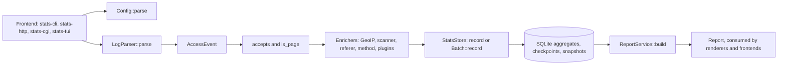

# `stats-core`

`stats-core` is the reusable domain layer. It has no command-line, HTTP, CGI, or
terminal responsibilities. Frontends use it to parse input, enrich events,
update storage, and query report data.

## Responsibilities

| Area | Implementation | Contract |
| --- | --- | --- |
| Configuration | `config.rs` | AWStats-style `Key=Value` subset, filters, timezone, periods, and plugin settings |
| Parsing | `parser.rs` | Apache/Nginx formats, AWStats time formats, JSON lines, and epoch timestamps |
| Event policy | `filter.rs`, `method_anomaly.rs`, `scanner.rs`, `referer_spam.rs` | Acceptance, page classification, and opt-in classifications |
| Enrichment | `geoip.rs`, `plugin.rs` | Optional GeoIP and event-enrichment callbacks |
| Input safety | `filesystem.rs`, `raw_log.rs` | Bounded paths and redacted raw-log output |
| Persistence | `store.rs` | SQLite aggregates, checkpoints, snapshots, metadata, and batch transactions |
| Report model | `report.rs` | Stable query structures consumed by all renderers |
| Rotation matching | `checkpoint_match.rs`, `prefix_hash.rs`, `source_key.rs` | Prefix identity and decoded-content matching for rotated inputs |

## Module map

`stats-core` has 16 modules declared in `crates/stats-core/src/lib.rs:1-16`, plus
the crate root `lib.rs` itself. The table lists all 17 source files in the order
they are declared.

| File | Role | Key items (file:line) |
| --- | --- | --- |
| `lib.rs` | Crate root: declares modules and the public re-exports | `pub use` surface, `lib.rs:18-45` |
| `checkpoint_match.rs` | Pure rotation decision logic, no I/O | `decide`, `Decision`, `AbortReason`, `StateRef`, `checkpoint_match.rs:52` |
| `config.rs` | Parses the `Key=Value` configuration and lookup files | `Config::parse` `config.rs:131-334`; `FilterConfig`, `DatabasePeriod`, `PluginConfig` |
| `filesystem.rs` | Path containment for read-only frontends | `FileSandbox::check_existing` `filesystem.rs:58-70` |
| `filter.rs` | Include and exclude filters, page classification | `accepts`, `is_page` `filter.rs:4-38` |
| `geoip.rs` | GeoIP lookup abstraction and MaxMind implementation | `GeoIp`, `MaxMindGeoIp::open` `geoip.rs:33-63`; non-routable addresses return the default `geoip.rs:109-126` |
| `hashfiles.rs` | Maps AWStats `hashfiles` persistence to the SQLite backend | `hashfiles_backend` `hashfiles.rs:13-18` |
| `method_anomaly.rs` | Flags HTTP methods outside the allow list | `MethodAnomalyMatcher::new`, `apply` `method_anomaly.rs:15-39` |
| `parser.rs` | Turns one log line into an `AccessEvent` | `LogParser::new` `parser.rs:125-143`, `parse` `parser.rs:145-234`, `AccessEvent` `parser.rs:8-29` |
| `plugin.rs` | In-process enrichers, renderer trait, and registry | `Enricher`, `ReportRenderer`, `PluginRegistry`, `GeoIpEnricher` `plugin.rs:44-125` |
| `prefix_hash.rs` | SHA-256 digests for checkpoint prefixes | `prefix_sha256`, `PrefixDigest` `prefix_hash.rs:10-42` |
| `raw_log.rs` | Bearer-token comparison and bounded, redacted raw-log lines | `bearer_token_matches`, `render_redacted`, `MAX_RAW_LOG_LINES = 10_000` `raw_log.rs:6-42` |
| `referer_spam.rs` | Referrer-domain rules: exclude or classify | `RefererSpamMatcher::parse`, `apply` `referer_spam.rs:54-116` |
| `report.rs` | Frontend-neutral `Report` and its builder | `ReportService::build` `report.rs:99-222`; label overlays `report.rs:238-279` |
| `scanner.rs` | URL rules for scanner probes and an optional 404 heuristic | `ScannerMatcher::parse`, `apply`, `apply_heuristic` `scanner.rs:49-138` |
| `source_key.rs` | Stable identity of one log family | `source_key` `source_key.rs:17-37` |
| `store.rs` | SQLite schema, aggregates, checkpoints, batch transactions | `SCHEMA_VERSION = "13"` `store.rs:8`; `with_batch` `store.rs:853-868`; tables `store.rs:91-107` |

## Data path

1. A frontend supplies `Config` and an input stream.
2. `LogParser` produces normalized `AccessEvent` values.
3. Filters decide whether an event contributes to the configured dimensions.
4. Enrichers add optional GeoIP, scanner, referer, or plugin information.
5. `StatsStore` records aggregates and checkpoint state.
6. `ReportService` reads aggregate tables into a frontend-neutral `Report`.

The flow below is the same path as the list above, with the storage branch
shown for the unpartitioned case.

The core does not know whether the caller is `update`, HTTP, CGI, TUI, or a
test. This keeps the statistical model independent from presentation and
deployment concerns.

## Persistence boundary

`StatsStore::record` remains a convenient single-event API. The CLI uses the
batch API for unpartitioned update and backfill so aggregate changes,
checkpoints, snapshots, and metadata commit together. Partitioned stores retain
their separate routing semantics; see [Operations](../operations.md#partitioning-and-retention).

## Public contract

The public report and storage types are the integration boundary for other
crates. Internal checkpoint columns and helper methods are bookkeeping details;
consumers should compare report aggregates rather than depend on checkpoint row
identity. Rotation behaviour is specified in the [rotation boundary contract](../rotation-boundary-contract/README.md).

The storage relationships are shown in the [persistence model](../architecture.md#persistence-model).
