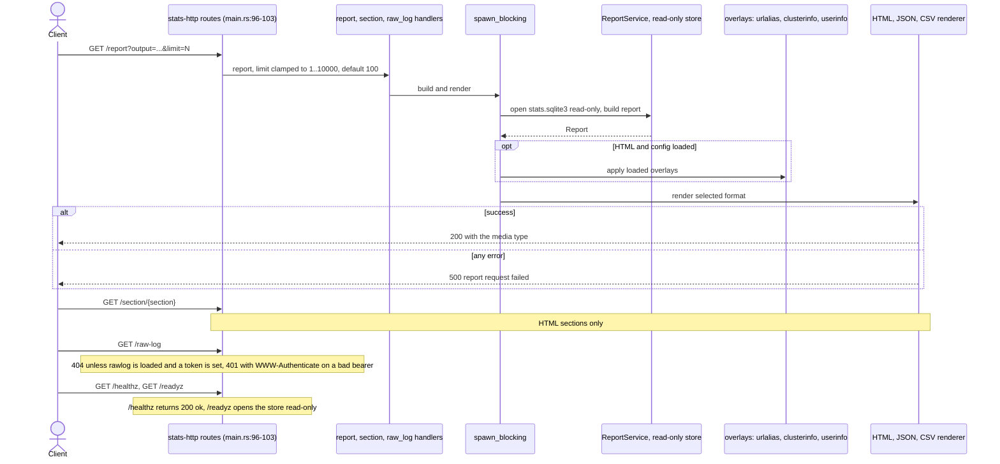
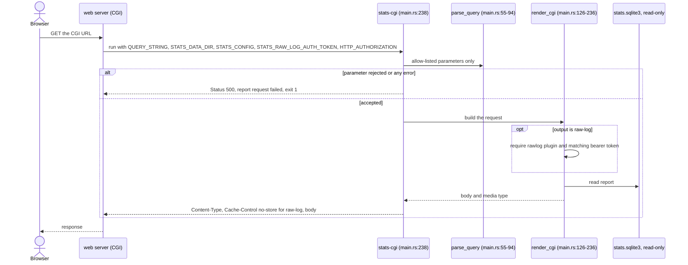

# Rendering and frontends

The workspace separates report data from presentation and transport. All
frontends query the `stats-core` report model; none should read SQLite tables
directly.

## Packages

| Package | Role | Boundary |
| --- | --- | --- |
| `stats-render` | HTML and native report renderer integration | Converts a `Report` into a site or plugin response |
| `stats-tui` | Ratatui dashboard | Reads report data and owns terminal interaction |
| `stats-http` | Standalone HTTP server | Serves reports and authenticated raw-log diagnostics |
| `stats-cgi` | CGI adapter | Maps CGI environment and query parameters to read-only output |
| `stats-cli` | Terminal commands and orchestration | Selects commands, output formats, and write paths |

## Rendering flow

The built-in HTML renderer is deterministic and offline. JSON and CSV are
external renderer plugins selected by configuration. The HTTP and CGI adapters
can expose configured report formats, while TUI and terminal summaries use
their dedicated renderers.

Raw-log output is a separate, bounded, redacted path. It is disabled by default
and must not be inferred from the presence of a renderer plugin. See
[Raw-log safety](../raw-log-safety.md).

## Failure boundary

Native report renderers run through supervised worker processes. The worker is the `stats-report-worker` binary, which must sit next to the frontend binary. A direct worker
crash, timeout, malformed response, or non-zero exit fails the request without
crashing the parent frontend. This is crash containment, not an OS sandbox;
event-enrichment callbacks and independently spawned descendants remain trusted
code. See the [plugin module guide](plugins.md#two-execution-paths).

## Request flows

### HTTP requests (D11)

### CGI requests (D12)

