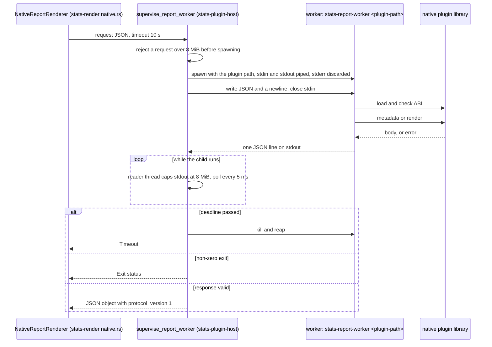
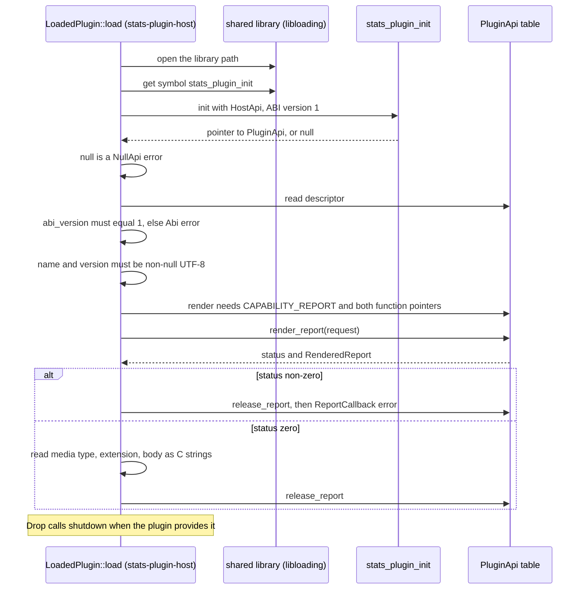

# Plugin system

The plugin system has two distinct paths: event enrichment and report
rendering. They share configuration vocabulary but have different execution and
failure boundaries.

## Packages and roles

| Package | Role |
| --- | --- |
| `stats-plugin-api` | Versioned C ABI types, descriptors, events, and renderer callbacks |
| `stats-plugin-host` | Dynamic loading, ABI checks, worker supervision, and response validation |
| `stats-core` | In-process Rust traits for event enrichers and report renderers |
| `stats-render` | Built-in renderers and adapters for configured native renderers |
| `plugins/report-*` | External HTML, JSON, and CSV renderer libraries |
| `plugins/example` | Minimal native plugin example |

## Two execution paths

Event enrichers receive normalized events during analysis and execute in the
analyzer process. They can affect event fields and are trusted deployment code.

Report renderers receive a bounded JSON report request in a short-lived worker
and return a media type, extension, and body through the ABI release callback.
The supervisor limits messages to 8 MiB. On Unix the worker leads its own process
group; on timeout, a malformed or failed response, or an unsuccessful exit, the
whole group receives SIGKILL before the request writer is joined. Processes that
leave the group (for example with `setsid`) are not reached. On other platforms
only the direct worker is killed, so descendants may outlive the request. The
supervisor provides no OS sandboxing.

## Configuration and deployment

Plugin paths are startup configuration, not request-controlled paths. Install
libraries in a trusted directory, validate ABI compatibility, and keep the
directory writable only by trusted deployers. See [Plugins](../plugins.md) for
the protocol details and [Deployment](../deployment.md) for service boundaries.

AWStats plugin names are compatibility aliases or adapter concepts, not a claim
that Perl plugins can be executed by this project. The status of each supported
family is recorded in the [parity manifest](../awstats-plugin-manifest.md).

## Worker and ABI flows

### Renderer worker supervision (D13)

### Plugin ABI: load and render (D14)

