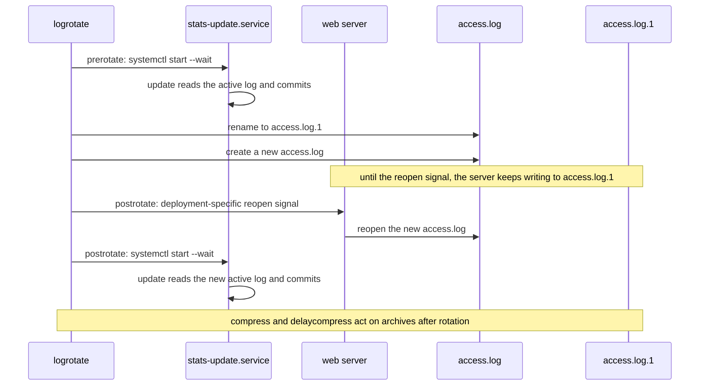

# Operations

## Incremental updates

`update` is cumulative by default. It appends unseen events to the existing
database and regenerates the complete HTML site at the default
`output/index.html` sibling of the configured data directory. Use
`report --output <path>` when a custom report location is required.

Each update is one all-or-nothing transaction for unpartitioned stores
(`DatabasePeriod` unset or `none`). Planning, parsing, aggregate updates, and
checkpoint writes commit together, or none of them do. A failure leaves the
database as it was before the command.

The updater analyzes only the configured active file. It does not open
`access.log.1`, `access.log.2`, or compressed archives during a normal update.

### Replacement and truncation are additive

When the active file is replaced or truncated, the new records are added to the
aggregates that already exist. The analyzer does not replay or remove earlier
statistics: the store keeps aggregates, not event rows, so already-counted events
cannot be taken back out. Before the old state is overwritten, its checkpoint is
kept as a snapshot, so a later copy of that content is recognized and not counted
again (see [copytruncate](#rotation-and-backfill)).

### Complete-line rule

Only newline-terminated lines of the active file are counted. A trailing fragment
that the web server has not finished writing is neither checkpointed nor imported.
When its newline arrives, the next update counts it once.

### Changing the configuration

The configuration file is part of the checkpoint identity. Changing it clears the
aggregates and checkpoints, then replays the active file. Archives are not
replayed, so after a configuration change run `backfill` again to restore the
archive history. Updates that only rename the hash of an unchanged configuration
keep all data (see [Checkpoint hashes](#checkpoint-hashes)).

Use `rebuild` only when intentionally clearing derived aggregates and replaying a
selected source. It is not the multi-file backfill operation.

## Rotation and backfill

For a conventional rotation directory, `backfill` discovers the configured active
filename plus numeric rotations such as `.1`, `.2.gz`, `.3.bz2`, and `.4.xz`, and
processes them oldest to newest in one transaction. It regenerates the site once at
the end. Do not call `backfill` from a recurring rotation hook; use it for an
explicit historical import after confirming the archive set is complete.

`backfill` checks the whole set before it writes anything. It reads each file, works
out which records each one shares with stored checkpoints, and aborts if any file is
ambiguous, corrupt, or overlaps another file in the same run. An abort exits
non-zero and changes nothing.

Historical files can also be supplied explicitly, oldest to newest:

The `logs/...` paths below are illustrative placeholders. Replace them with
the actual active log and rotated archives for the deployment.

```text
cargo run -p stats-cli -- update --config logs/awstats.example.test.conf --log-file logs/access.log.2.gz --data-dir stats
cargo run -p stats-cli -- update --config logs/awstats.example.test.conf --log-file logs/access.log.1 --data-dir stats
cargo run -p stats-cli -- update --config logs/awstats.example.test.conf --log-file logs/access.log --data-dir stats
```

`.gz`, `.bz2`, and `.xz` files are decompressed for parsing. Repeated unchanged
invocations are recognized by stored checkpoints and do not duplicate events.

### Compressed rotations

A rotation that is compressed after it was counted as the active file (for
example `delaycompress` followed by `compress`) is recognized by its content: its
decoded records are matched against the stored prefix of the active file, and the
shared records are counted once. The same applies to bzip2 and xz archives.

### copytruncate

With `copytruncate`, the active file is copied and then truncated in place. The
copy holds the content the active file had before truncation. That content is kept
as a snapshot when the truncated file is next updated, so the copy is recognized and
not counted again.

### Overlap is rejected before any write

`backfill` rejects two files in one run whose complete streams overlap at the
start, whether they are identical or one is shorter than the other. Such a set is
not a normal rotation sequence, and counting it would count the shared records
twice:

```text
backfill aborted: access.log.1.gz begins with all of access.log.2.gz for source ...,
so the shared records would be counted twice; remove one of them; no changes were written
```

Remove the duplicate and rerun. Overlap that spans files without starting at the
same records is not detected; see [Limitations](#limitations).

### Recommended rotation order

Run update, generate the report, rotate the log, let the web server reopen its
log file, create the new active file, and update again when new lines arrive.
Existing aggregates are not deleted during normal rotation handling.

### Requirement: reopen the log after rotation

After the log is renamed, the web server must reopen its log file before the next
update. Otherwise it keeps writing to the renamed file, and the new active file
never receives those records. The analyzer cannot detect this. Configure the
logrotate `postrotate` hook to send the server's reopen signal, before the update
runs (see the placeholder in `deploy/stats-logrotate`). Nginx, for example, reopens
on `USR1`.

The rotation hooks in the supplied template run in this order. Backfill is not
part of the hooks; an operator runs it when the archive set is complete.



### Recovery for legacy compressed checkpoints

Databases written before checkpoint matching was added have rows without the
stable prefix fields. Such a row cannot prove that a compressed archive does not
overlap it. A `backfill` that meets such an archive therefore aborts with:

```text
backfill aborted: compressed archive ... cannot be checked against legacy checkpoints for source ...
```

Recover by rebuilding from the complete set, oldest archive first, then updating
the rest in order. Every archive in the rotation must be included, because
`rebuild` clears all aggregates before it counts its file:

```text
rebuild --config <config> --log-file <oldest archive>
update  --config <config> --log-file <next archive>
...
update  --config <config>                      # the configured active log
backfill --config <config> --log-dir <dir>     # now a no-op
```

An archive that is left out of the sequence is absent from the totals. After
recovery, `backfill` changes nothing, and new rows carry the stable fields, so this
step is not needed again for that source.

## Checkpoint hashes

Configuration fingerprints are SHA-256 in new databases. Earlier versions used a
hash that is not stable across Rust releases. On the first update after upgrading,
a stored legacy hash for the same configuration is renamed in place to the SHA-256
fingerprint on every checkpoint and snapshot row. Aggregates and checkpoints are
kept. Only a different configuration clears them.

## Locking

Commands that write take an exclusive lock on `DirData/stats.lock`: `update`,
`backfill`, `rebuild`, `migrate`, `optimize`, and `retention --remove-source`.
`watch`, `live`, and `tui` take the lock for each refresh and release it between
refreshes, so manual commands can run in between. A command that finds the lock
held exits with `another stats process holds ...` and writes nothing. The lock is
advisory and Unix-only; on other platforms concurrent writers are not prevented.

Cost: a write holds the lock for its whole run. A `backfill` with more than one file
reads each file three times: once to plan, once to check its overlap with the other
files, and once more to apply. A normal `update` reads the active file twice: once to
plan and once to apply, and only up to its size at the start of the run. Large
archives therefore block other writers for that time. Schedule large backfills
outside the regular update window.

## Partitioning and retention

For large retention periods, add `DatabasePeriod=monthly` or `DatabasePeriod=yearly`.
The control database remains at `DirData/stats.sqlite3`; event aggregates are
stored under `DirData/periods/YYYY-MM/stats.sqlite3` or
`DirData/periods/YYYY/stats.sqlite3`. Reports, summaries, and the TUI merge all
period databases automatically, while shared control session state preserves
continuity across boundaries. Late or out-of-order input remains approximate.

Partitioned stores have these limits:

- `backfill` is refused: `backfill is not supported when DatabasePeriod is set`.
  Import archives into a single-database store, or use `migrate` below.
- `update` writes events one at a time, not in one transaction, and does not keep
  copytruncate snapshots. A failure mid-update can leave the period databases and
  checkpoints out of step.

`retention --before YYYY-MM` or `--before YYYY` lists matching old partitions
without changing them. Add `--archive-dir` to create consistent SQLite snapshots
under `archive-dir/periods/...`; add `--remove-source` only after verifying the
archive. The archive directory must be separate from the live data directory.

## SQLite maintenance and backups

SQLite uses WAL mode, a five-second busy timeout, normal synchronous durability,
and in-memory temporary storage. Run `optimize` after large ingestion batches;
add `--vacuum` during a maintenance window when reclaiming deleted space is
worth the exclusive rewrite cost. `storage` includes SQLite `-wal` and `-shm`
sidecars in its totals.

Use `backup` for consistent snapshots of control and period databases. The
destination must not already exist; the command uses SQLite's online `VACUUM INTO`
snapshot mechanism and preserves the partition layout.

To migrate an existing single database, first set `DatabasePeriod=monthly` or
`DatabasePeriod=yearly`, then run `migrate`. It requires a new backup directory,
backs up current data, clears active aggregates, and replays every discovered
log into the partitions. This is a separate replay path: the public `backfill`
command refuses partitioned stores, but `migrate` still imports every archive. Keep
the backup until new totals are verified. If migration is interrupted, keep the
backup and rerun with a different backup directory only after checking the
destination data; `migrate` refuses to overwrite an existing backup directory.

## Data interpretation

Reports include source/configuration fingerprints, schema metadata, entry/exit
page dimensions, and approximation notes so consumers can distinguish measured
values from heuristic visitor, session, and bot metrics. A change of schema
version clears aggregates and checkpoints when the store opens. Archives are not
replayed by that step, so run `backfill` again after a schema upgrade.

Visit and unique-visit keys are deterministic pseudonymous FNV-1a aggregation
identifiers. Raw client IP addresses are not stored, but these keys are not
cryptographic anonymization and should be protected as derived analytics data.

## Limitations

- Overlap detection in one run catches identical files and files where one begins
  with another. An archive that ends mid-line and is continued by another file is
  not detected.
- A copy made without truncating the active file (`copy` without `truncate`) is
  not recognized as already counted. Its records are counted again.
- Legacy rows need the recovery procedure above before compressed archives can be
  backfilled.
- The writer lock does not protect non-Unix platforms.
