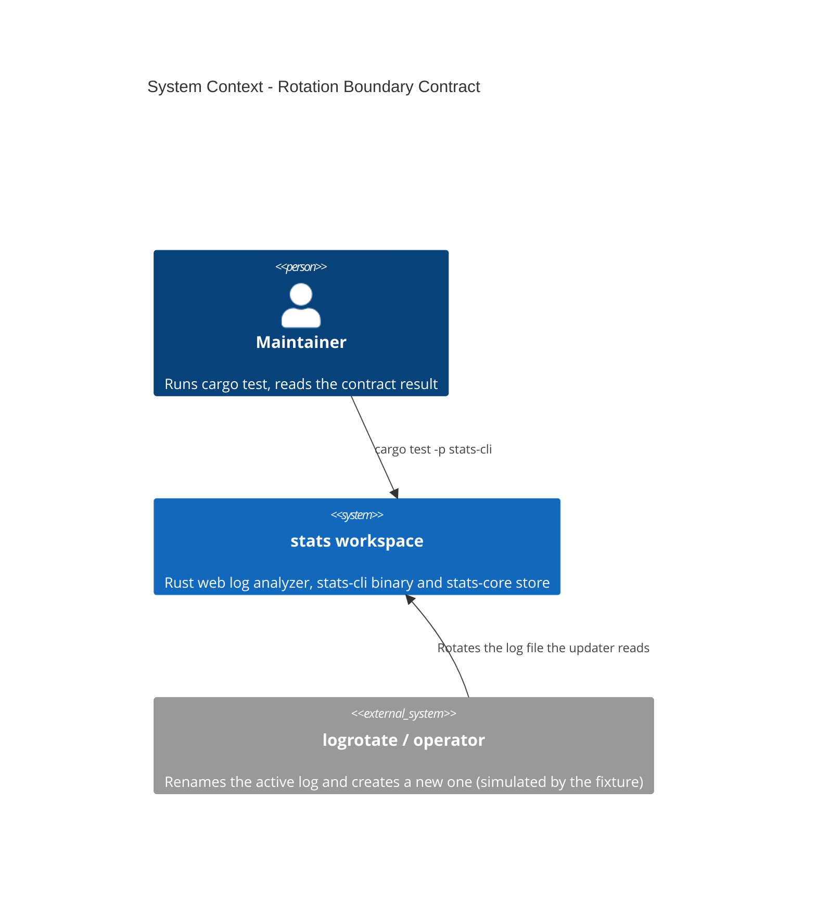
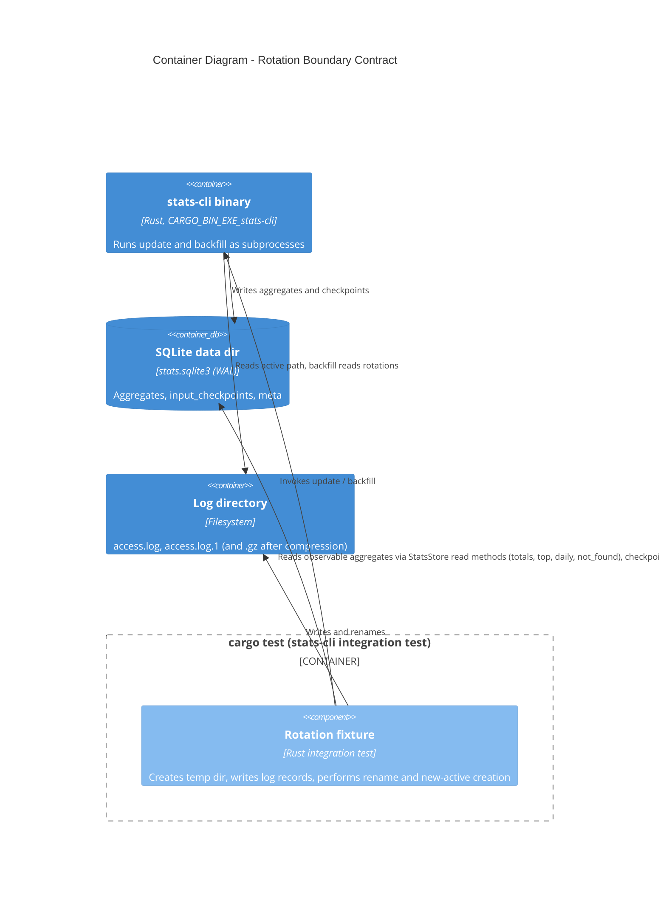
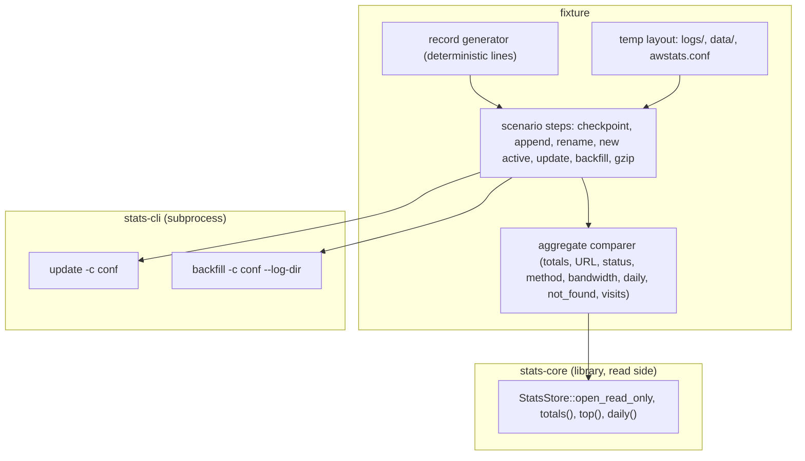
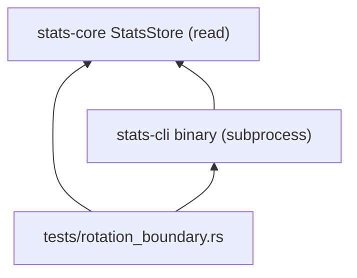

# Architecture: Rotation Boundary Contract

## C4 Level 1 - System Context

Actors: the maintainer runs the suite; logrotate or an operator performs the rotation, which the fixture reproduces with `rename` and file creation. There are no network dependencies. GeoIP, plugins, and reverse DNS are disabled in the fixture config.

## C4 Level 2 - Container

Communication is subprocess invocation and direct file and SQLite access. The fixture drives the public CLI surface rather than calling `update_inner` directly, because that function is private to `../../crates/stats-cli/src/main.rs` (`:784`). Running the binary also exercises config loading, `StoreRouter`, and report regeneration, which the boundary depends on.

## C4 Level 3 - Component

### 3.1 Rotation fixture (`../../crates/stats-cli/tests/rotation_boundary.rs`, new)

**Description:**
- Record generator: produces combined-format lines with fixed timestamps and deterministic IPs, paths, and byte counts, so every run is reproducible.
- Temp layout: one directory per test under `std::env::temp_dir()`, named with the process id and test name, as in `crates/stats-cli/tests/native_report_failure.rs:19-22`.
- Scenario steps: the sequence in `02-behavior.md`.
- Aggregate comparer: compares the `totals` table (hits, bytes) and the `top`/`daily` aggregates between the scenario database and the clean-import database. Strict equality, not tolerance.

**State machine:** not applicable. The fixture has no state beyond the on-disk files.

### 3.2 Existing components exercised (no changes proposed)

| Component | Location | Role in the fixture |
|---|---|---|
| `update` / atomic update path | `crates/stats-cli/src/main.rs`, `atomic_update.rs` | Normal update reads only the configured active path; unpartitioned writes are planned and applied atomically |
| `backfill` / file discovery | `crates/stats-cli/src/main.rs`, `atomic_update.rs` | Discovers rotations oldest-first and applies the validated file set |
| Checkpoint matching | `crates/stats-core/src/checkpoint_match.rs`, `prefix_hash.rs`, `source_key.rs` | Identity and decoded-prefix matching scoped to one source |
| File identity | `crates/stats-cli/src/main.rs` | `dev:ino` on Unix; portable fallback elsewhere |
| `StatsStore` read API | `../../crates/stats-core/src/store.rs` | Aggregate comparison only |
| Checkpoint and snapshot state | `../../crates/stats-core/src/store.rs` | Internal bookkeeping used by the updater, not read by the fixture |

## Module Dependency graph

**Rule:** the fixture depends on the binary and the public `stats-core` read API only. It does not import `main.rs` internals and adds no production-code dependency.
